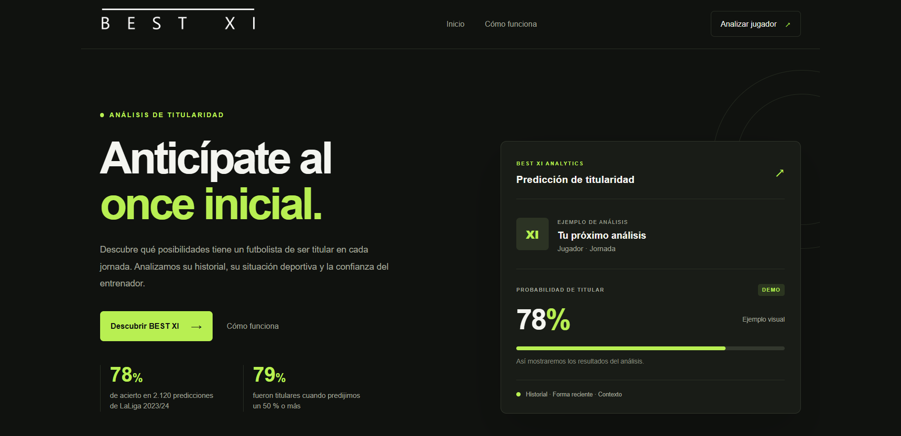
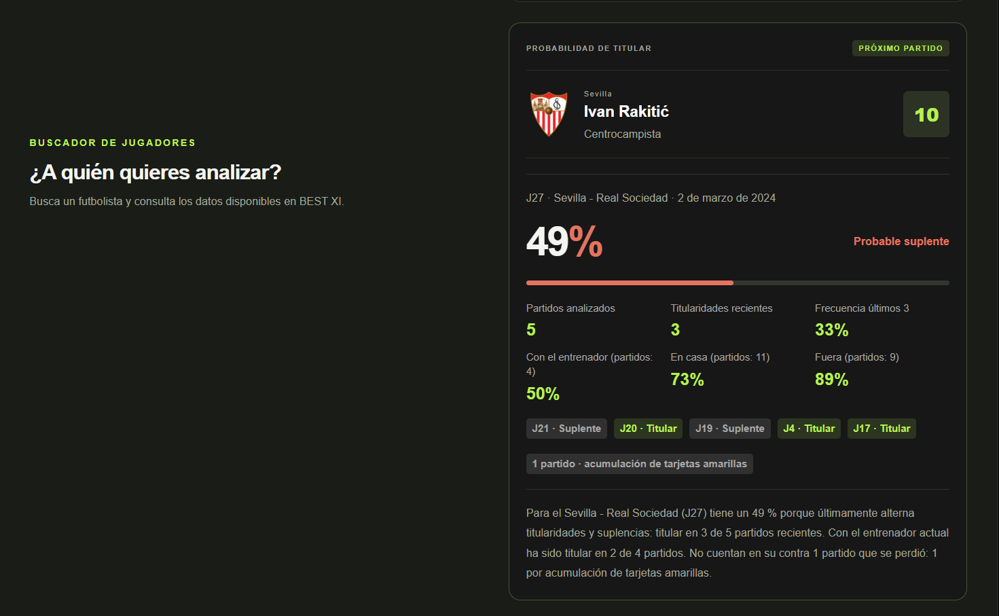

# BEST XI

Aplicación web que predice la probabilidad de que un futbolista de LaLiga sea **titular** en un partido y explica el resultado con palabras sencillas.

🔗 **Pruébala aquí: [best-xi-lake.vercel.app](https://best-xi-lake.vercel.app)**

> El servidor está en un plan gratuito y se duerme tras un rato sin visitas: la primera búsqueda puede tardar alrededor de un minuto. Las siguientes son inmediatas.



## Qué hace

1. **Buscas un jugador** por su nombre. No hace falta escribir tildes ni mayúsculas: «veliz» encuentra a Alejo Véliz.
2. **Eliges el partido**: el próximo partido de su equipo o una jornada concreta.
3. **Obtienes su ficha**: probabilidad de ser titular, rival, fecha y una explicación del porqué (forma reciente, confianza del entrenador, rendimiento en casa y fuera, y ausencias por lesión o sanción).



## Los datos

Datos reales de **LaLiga 2023/24** obtenidos de [API-Football](https://www.api-football.com/): partidos, alineaciones, entrenadores e incidencias (lesiones y sanciones).

- Temporada completa de **Real Betis, Sevilla y Villarreal**: 38 partidos cada uno, con alineaciones e incidencias.
- Como es una temporada ya terminada, la aplicación usa el **1 de marzo de 2024** como fecha de «hoy». Así, «próximo partido» tiene sentido igual que si la temporada estuviera en juego.

## Cómo se calcula la predicción

La probabilidad combina cuatro factores del historial del jugador **antes** del partido que se predice:

| Factor | Peso |
|---|---|
| Titularidades en los últimos 3 partidos | 40 % |
| Titularidades en los últimos 5 partidos | 30 % |
| Titularidades con el entrenador actual | 20 % |
| Titularidades en toda la temporada | 10 % |

Si el entrenador acaba de llegar y aún hay pocos partidos con él, se usa una ponderación alternativa. Las ausencias justificadas (lesión o sanción) no cuentan en contra del jugador.

### ¿Acierta?

Se ha comprobado con un *backtest*: se predice cada partido de la temporada usando solo lo ocurrido antes de él y se compara con la alineación real. Se tiene en cuenta solo a los convocados y se considera «titular» una predicción igual o superior al 50 %.

| Resultado | Valor |
|---|---|
| Acierto global (2.120 predicciones) | **78 %** |
| Jugadores con predicción ≥ 50 % que fueron titulares | 79 % |
| Jugadores con predicción ≥ 70 % que fueron titulares | 83 % |
| Jugadores con predicción < 30 % que fueron titulares | 19 % |

Los pesos se ajustaron con los datos del Betis. Sevilla y Villarreal no se usaron para ajustarlos, y en ellos el acierto fue del 79 % y el 77 %.

## Tecnologías

| Parte | Tecnología |
|---|---|
| Backend | Java 21, Spring Boot 4, Spring Data JPA, Flyway |
| Base de datos | PostgreSQL 16 |
| Frontend | React 19 + Vite |
| Datos | API-Football |
| Extra | Bot de Telegram que responde con la misma predicción |
| Despliegue | Vercel (web), Render con Docker (backend), Neon (base de datos) |

```
Navegador ──► Vercel (React) ──► Render (Spring Boot) ──► Neon (PostgreSQL)
```

## API

| Método | Ruta | Qué devuelve |
|---|---|---|
| GET | `/api/jugadores?nombre=fekir` | Hasta 10 jugadores cuyo nombre contiene el texto |
| GET | `/jugadores/{id}/titularidad?ultimosPartidos=5&jornada=30` | Predicción para el partido de esa jornada |
| GET | `/jugadores/{id}/titularidad/proximo-partido?ultimosPartidos=5` | Predicción para el próximo partido del equipo |

Ejemplo: [`/api/jugadores?nombre=fekir`](https://best-xi.onrender.com/api/jugadores?nombre=fekir)

## Arrancarlo en local

**Requisitos:** Java 21, Node.js y Docker Desktop. Los comandos son para Windows (PowerShell).

```powershell
# 1. Base de datos (desde la raíz del proyecto)
docker compose up -d

# 2. Backend → http://localhost:8080
.\mvnw.cmd spring-boot:run

# 3. Frontend → http://localhost:5173 (en otra terminal)
cd frontend
npm.cmd install
npm.cmd run dev
```

La base de datos empieza vacía. Para cargar un equipo hace falta una clave de API-Football (`API_FOOTBALL_KEY`) y llamar, en este orden, a:

```
POST /admin/sync/partidos?liga=140&temporada=2023&equipoId=543
POST /admin/sync/alineaciones/equipo?equipoId=543
POST /admin/sync/incidencias?liga=140&temporada=2023&equipoId=543
```

### Variables de entorno

Todas son opcionales en local: si no existen, se usan los valores del `docker-compose.yml` y de `localhost`.

| Variable | Para qué sirve |
|---|---|
| `DB_URL`, `DB_USUARIO`, `DB_PASSWORD` | Conexión a PostgreSQL |
| `CORS_ORIGENES` | Webs que pueden llamar al backend, separadas por comas |
| `API_FOOTBALL_KEY` | Clave de API-Football, solo para importar datos |
| `TELEGRAM_BOT_TOKEN` | Token del bot de Telegram |
| `TELEGRAM_ACTIVO` | `false` para arrancar sin el bot |
| `ADMIN_ACTIVO` | `false` para desactivar los endpoints `/admin` (así está en el servidor) |
| `VITE_API_URL` | Dirección del backend que usa el frontend |

## Estructura

```
best-xi/
├── src/main/java/com/bestxi/
│   ├── apifootball/   Importación de datos desde API-Football
│   ├── titularidad/   Cálculo de la predicción y su explicación
│   ├── jugadores/     Buscador de jugadores
│   ├── backtest/      Validación del modelo
│   ├── telegram/      Bot de Telegram
│   ├── model/         Entidades (Jugador, Equipo, Partido, Alineación…)
│   └── config/        CORS y configuración
├── src/main/resources/db/migration/   Tablas (Flyway)
├── frontend/          Web en React + Vite
├── Dockerfile         Imagen del backend para Render
└── docker-compose.yml PostgreSQL en local
```

## Autor

Carlos Rojas · [GitHub](https://github.com/CarlosRojasCode)
